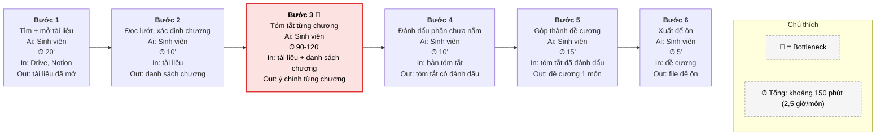
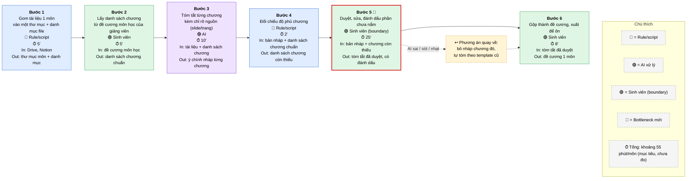

# Báo cáo nhóm — Day 02 Discovery & Problem Framing

> Bản chung của nhóm, viết trên repo do nhóm trưởng fork. Không copy file này sang repo cá nhân.
> Template chi tiết và prompt mẫu: [docs/01-worksheet.md](../../docs/01-worksheet.md). Bài mẫu: [docs/02-deliverable-example.md](../../docs/02-deliverable-example.md).

## 1. Thông tin nhóm

- Tên nhóm: K5-L3A-Day02-NhomNewbie-DiscoveryProblemFraming
- Thành viên: xem `TEAM.md`
- Candidate problem được chọn (1 câu): Dựng đề cương ôn tập
- Quyết định cuối: Not Yet

---

## 2. Hội tụ nhóm (CP3)

### 2.1. Pitch

| # | Người đưa ra | Candidate (Job Story ngắn) | Actor | Bottleneck | Câu hỏi phản biện nhận được (ai hỏi) |
|---:|---|---|---|---|---|
| 1 | | | | | |
| 2 | | | | | |
| 3 | | | | | |
| 4 | | | | | |
| 5 | | | | | |
| 6 | | | | | |
| 7 | | | | | |
| 8 | | | | | |
| 9 | | | | | |
| 10 | | | | | |
| 11 | | | | | |
| 12 | | | | | |

### 2.2. Cluster

| Cluster | Các candidate | Pattern chung |
|---|---|---|
| A | | |
| B | | |
| C | | |

### 2.3. Opportunity Solution Tree rút gọn

Gốc là **1 outcome**. Nhánh là **opportunity** (nhu cầu, pain), không phải tính năng hay công cụ.

```text
OUTCOME: 
├── Opportunity A: 
├── Opportunity B: 
└── Opportunity C: 
```

Những ý đã gạch bỏ vì là solution đội lốt opportunity:

-

### 2.4. Chấm điểm shortlist (1–5)

| Candidate | Actor rõ | Quy trình rõ | Pain có bằng chứng | Impact đo được | Vừa sức lab | So sánh được No AI/Rule/Workflow/Agent | Nhóm hiểu domain | Tổng |
|---|---:|---:|---:|---:|---:|---:|---:|---:|
| | | | | | | | | |
| | | | | | | | | |
| | | | | | | | | |

**Candidate được chọn:**

**Vì sao chọn:**

**Vì sao loại các candidate còn lại:**

**Xử lý bất đồng (nếu có):**

---

## 3. Kiểm chứng + research giải pháp đã có (CP4)

### 3.1. Assumption Map

| # | Giả định | Loại (Value / Usability / Feasibility / Viability) | Quan trọng (1–5) | Đã có bằng chứng (1–5) | Kiểm chứng trước? |
|---:|---|---|---:|---:|---|
| 1 | | | | | |
| 2 | | | | | |
| 3 | | | | | |
| 4 | | | | | |
| 5 | | | | | |
| 6 | | | | | |

*Điền 4–6 giả định; xóa dòng thừa.*

Giả định nhóm kiểm chứng trong buổi này:

### 3.2. Kiểm chứng

Cách đã dùng: Phỏng vấn / Survey / Log, ticket, review

Interview snapshot (mỗi buổi phỏng vấn một bảng, hoặc đặt file trong `report/assets/cp4-interview-snapshot-N.md`):

| Trường | Nội dung |
|---|---|
| Người được hỏi (vai trò, không ghi tên thật) | |
| Câu nói đáng nhớ nhất (nguyên văn) | |
| Lần gần nhất gặp vấn đề này: chuyện gì đã xảy ra? | |
| Hiện đang xử lý bằng cách nào (workaround)? | |
| Mất bao lâu, bao lần? | |
| Insight / opportunity rút ra | |

Tổng hợp:

| Nguồn | Số người / số mẫu | Tín hiệu xác nhận | Tín hiệu phản bác |
|---|---:|---|---|
| | | | |

**Nhóm đã sửa problem thế nào sau kiểm chứng:**

### 3.3. Research giải pháp đã có

| Công cụ / case / pattern | Link | Giải bước nào trong quy trình? | Điểm mạnh | Khoảng trống / rủi ro | Bài học cho nhóm |
|---|---|---|---|---|---|
| | | | | | |
| | | | | | |
| | | | | | |

---

## 4. Quy trình trước/sau (CP5)

### 4.1. Quy trình hiện tại

Sơ đồ (ASCII, Mermaid hoặc link ảnh trong `report/assets/`):

```text
cp5-workflow-current.jpeg
```
**Current Workflow**



| Bước | Actor | Input | Output | Thời gian / tần suất | Ghi chú |
|---:|---|---|---|---|---|
| 1. Tìm và mở lại tài liệu | Sinh viên | Slide, giáo trình trên Drive; ghi chú trên Notion | Tài liệu của 1 môn đã mở sẵn | ~20'/môn, 6 môn/đợt ôn |  |
| 2. Đọc lướt, xác định các chương | Sinh viên | Tài liệu đã mở, danh mục môn | Danh sách chương cần tóm tắt | ~10'/môn | Danh mục chương của giảng viên là mốc đối chiếu về sau |
| 3. Tóm tắt từng chương thành ý chính  | Sinh viên | Slide + giáo trình + ghi chú của từng chương (thứ tự dựa trên danh sách chương) | Ý chính từng chương | ~90-120'/môn (trong tổng 2-3 giờ) | Đọc lại và chọn ý, chưa tách rõ “đọc” với “viết”. Có thể đọc chiếm phần lớn thời gian |
| 4. Đánh dấu phần mình chưa nắm | Sinh viên | Bản tóm tắt ý chính từng chương | Bản tóm tắt có đánh dấu chỗ yếu | ~10'/môn | Dựa vào cảm giác chủ quan |
| 5. Gộp lại thành đề cương | Sinh viên | Bản tóm tắt đã đánh dấu | Đề cương 1 môn | ~15'/môn |  |
| 6. Xuất ra để ôn | Sinh viên | Đề cương | File/trang dùng để ôn | ~5'/môn | Chưa rõ định dạng (Notion, PDF, giấy) |

**Bottleneck chính:** Bước 3, tóm tắt từng chương: khoảng 90-120 phút trong tổng ~2,5 giờ/môn (chiếm khoảng 60-70%).  
Lý do là bottleneck:
- Bước lớn nhất theo thời lượng.
- Là bước duy nhất vừa phải đọc nhiều tài liệu, vừa phải chọn ý, nên đúng chỗ công cụ tóm tắt có thể hỗ trợ.


### 4.2. Quy trình tương lai

Ghi rõ bước nào **Rule**, bước nào **AI**, bước nào **con người**, **boundary** ở đâu, **phương án quay về** khi AI sai.

```text
cp5-workflow-future.jpeg
```
**Future Workflow**



| Bước | Loại | Actor | Input | Output | Thời gian / tần suất | Ghi chú |
|---:|---|---|---|---|---|---|
| 1. Gom tài liệu 1 môn | Rule/script | Công cụ | Slide, giáo trình trên Drive; ghi chú trên Notion | Thư mục môn + danh mục file | ~5' (hiện ~20') | Việc cố định, không cần hiểu nội dung. Cần quyền truy cập Drive và Notion. Chưa chắc làm được tự động hoàn toàn |
| 2. Lấy danh sách chương chuẩn | Con người | Sinh viên | Đề cương môn học của giảng viên | Danh sách chương chuẩn | ~5' (hiện ~10') | Để sinh viên làm, không để AI tự suy ra chương. Đây là mốc kiểm tra độ phủ. Thời gian giảm xuống nếu có đề cương từ giảng viên. Nếu không có thì giữ nguyên như hiện tại |
| 3. Tóm tắt từng chương | AI | AI | Thư mục môn + danh mục file (từ bước 1) + Danh sách chương chuẩn (từ bước 2) | Bản nháp tóm tắt từng chương (có chỉ nguồn) | ~10' (hiện 90-120') | Bước thay thế bottleneck cũ. Bắt buộc chỉ rõ nguồn để sinh viên kiểm tra |
| 4. Đối chiếu độ phủ | Rule/script | Công cụ | Bản nháp tóm tắt từng chương (từ bước 3) + Danh sách chương chuẩn (từ bước 2) | Danh sách chương còn thiếu | ~2' | So khớp tên chương, không cần AI |
| 5. Duyệt, sửa, đánh dấu phần chưa nắm | Con người (boundary) | Sinh viên | Bản nháp tóm tắt từng chương (từ bước 3) + Danh sách chương còn thiếu (từ bước 4) + Thư mục môn + danh mục file (từ bước 1, để đối chiếu nguồn) | Bản tóm tắt đã duyệt, có đánh dấu chỗ yếu | ~25' | Gộp bước “duyệt” với bước “đánh dấu” cũ. Bottleneck mới. Gộp hai việc thực hiện cùng một lượt đọc, chưa đo riêng từng việc. Nếu khi đo riêng bước nào chiếm nhiều thời gian hơn thì Bottleneck mới sẽ ở bước đó |
| 6. Gộp và xuất đề cương | Con người | Sinh viên | Bản tóm tắt đã duyệt, có đánh dấu chỗ yếu (từ bước 5) | Đề cương 1 môn |~8' | Dùng template đề cương có sẵn |

**Tổng:** khoảng 55 phút/môn (hiện khoảng 150 phút). Mục tiêu là dưới 60 phút/môn.  

**Boundary: AI không được làm gì**
- Không tự quyết định chương nào được bỏ qua.
- Không tự đánh dấu một chủ đề là “đã nắm”. Việc này chỉ sinh viên làm.
- Không thêm kiến thức ngoài tài liệu đã gom (để tránh bịa).
- Không sửa hoặc xóa tài liệu gốc.
- Không để sinh viên dùng bản nháp để ôn khi chưa qua bước 5.

**Phương án quay về**
| Tình huống | Làm gì |
|---:|---|
| AI tóm sai, sót ý hoặc quá nhạt ở một chương | Bỏ bản nháp chương đó, sinh viên tự tóm theo template đề cương cũ. Chương còn lại giữ nguyên |
| Bước 4 báo nhiều chương thiếu | Chạy lại bước 3 cho các chương đó. Nếu vẫn thiếu, tự tóm tay |
| AI hoặc script ngừng hoạt động | Quay về quy trình hiện tại ở mục 4.1 (khoảng 150 phút/môn). Mất thời gian nhưng không mất đề cương |

**Bottleneck mới**: Bước 5: sinh viên duyệt, sửa, đánh dấu phần chưa nắm (~25 phút). Chấp nhận được vì đây là điểm kiểm soát chất lượng. Nếu rút ngắn quá mức thì AI sai không bị phát hiện, và đó chính là rủi ro lớn nhất của candidate này.

### 4.3. Before / after

| Chỉ số | Trước | Sau (kỳ vọng) | Ghi chú |
|---|---:|---:|---|
| Số bước | 6 | 6 | Số bước không giảm. Cái đổi là ai làm từng bước . Bước “đánh dấu phần chưa nắm” được gộp vào bước duyệt, nhưng thêm 2 bước mới là lấy danh sách chương chuẩn và đối chiếu độ phủ |
| Tổng thời gian | ~150 phút/môn (2,5 giờ), 6 môn ≈ 15 giờ | ~55 phút/môn, 6 môn ≈ 5,5 giờ | Giảm khoảng 95 phút/môn (khoảng 63%). Đạt mục tiêu dưới 60 phút/môn của card. Số “trước” có thể lên 180 phút nếu bước tóm tắt mất 120 phút. Số “sau” chưa ai thử, nên cần bấm giờ thật |
| Số bước thủ công | 6 trên 6 (toàn bộ do sinh viên làm tay) | 3 trên 6 (bước 2, 5, 6) | Rule/script làm 2 bước (gom file, đối chiếu chương), AI làm 1 bước (tóm tắt). Thời gian làm tay còn ~38 phút trong tổng 55 phút |
| Bottleneck chính | Bước tóm tắt từng chương, ~90-120 phút (60-70% tổng thời gian) | Bước sinh viên duyệt, sửa, đánh dấu, ~25 phút (~45% tổng thời gian) | Bottleneck chuyển từ “tự tạo nội dung” sang “kiểm tra nội dung”. Chấp nhận được vì đây là điểm kiểm soát chất lượng, không nên rút ngắn thêm |
| Rủi ro mới phát sinh | Không có rủi ro từ AI. Rủi ro hiện có: tự tóm tắt bị sót chương mà không biết | 1. AI tóm sai, sót ý hoặc bịa<br>2. Sinh viên tin bản nháp mà duyệt qua loa<br>3. Script gom file lỗi hoặc thiếu quyền truy cập<br>4. Tên chương trong slide không khớp đề cương, script đối chiếu sai<br>5. Phụ thuộc vào công cụ bên ngoài | Cách giảm: bắt buộc AI chỉ rõ nguồn (slide/trang), có bước đối chiếu độ phủ chương, có phương án quay về (tự tóm theo template cũ). Rủi ro 2 là rủi ro nguy hiểm nhất, vì mất hết lợi ích nếu duyệt hời hợt |

---

## 5. Problem Statement v0 (CP5)

| Trường | Nội dung |
|---|---|
| **Actor** | Sinh viên đại học tự dựng đề cương ôn thi cho nhiều môn (khoảng 6 môn/kỳ) từ slide, giáo trình và ghi chú nằm rải ở Drive, Notion |
| **Quy trình** | Mỗi đợt ôn thi, với từng môn, sinh viên tìm và mở lại tài liệu, đọc lướt để xác định các chương, tóm tắt từng chương thành ý chính, đánh dấu phần chưa nắm, gộp thành đề cương rồi xuất ra để ôn |
| **Bottleneck** | Bước tóm tắt từng chương mất khoảng 90-120 phút/môn (60-70% tổng thời gian), vì sinh viên phải đọc lại toàn bộ tài liệu rồi tự chọn ý chính. Giả định, chưa bấm giờ, chưa tách riêng “đọc” và “viết” |
| **Impact** | Khoảng 150 phút/môn, 6 môn ≈ 15 giờ mỗi đợt ôn thi. Càng gần ngày thi càng dồn việc, dễ bỏ sót chương và ôn dàn trải |
| **Success Metric** (baseline → target, cách đo) | Giảm thời gian dựng đề cương từ khoảng 150 phút xuống dưới 60 phút/môn; không bỏ sót chương nào so với đề cương môn học của giảng viên. Cách đo: bấm giờ từng bước khi dựng đề cương 1 môn, trước và sau; đối chiếu danh sách chương trong đề cương với danh mục chương của giảng viên. |
| **Boundary** (AI không được làm gì; khi nào cần con người kiểm tra — HITL) | AI không tự quyết định chương nào được bỏ qua; không tự đánh dấu một chủ đề là “đã nắm”; không thêm kiến thức ngoài tài liệu đã gom; không sửa hoặc xóa tài liệu gốc. Sinh viên không dùng bản nháp để ôn khi chưa duyệt xong. Nếu AI sai hoặc ngừng hoạt động, sinh viên quay về tự tóm tắt theo template cũ. |

Phản biện nhận được (từ AI hoặc nhóm khác) và nhóm có đồng ý không:

| Phản biện | Đồng ý? | Cách sửa đề xuất |
|---|---|---|
| NotebookLM và công cụ tương tự đã làm tốt bước tóm tắt, nên problem này có thể đã được giải | Đồng ý | Thu hẹp problem thành “kiểm tra bản tóm tắt AI có phủ hết chương và đúng ý không” |
| Sinh viên có thể duyệt bản AI qua loa, mất lợi ích kiểm soát | Đồng ý | Thêm bước đối chiếu độ phủ chương bằng script, và yêu cầu AI chỉ rõ nguồn (slide/trang) |
| Chỉ đo thời gian là chưa đủ, đề cương ngắn nhưng sai vẫn “thắng” | Đồng ý | Giữ điều kiện “không bỏ sót chương nào”. Thêm chỉ số: mỗi người làm thử 5 câu hỏi ôn từ đề cương, đếm câu không tìm được đáp án |

---

## 6. Mức can thiệp AI (CP6)

### 6.1. Ma trận độ mơ hồ × độ phức tạp

Bài của nhóm nằm ở ô: **Độ phức tạp cao × Độ mơ hồ cao**.

Vì sao:
- Độ phức tạp cao: quy trình có 6 bước nối tiếp, bước sau phụ thuộc bước trước, không có danh sách chương chuẩn thì không tóm tắt được từng chương. Tài liệu gồm 3 loại slide, giáo trình, ghi chú đều nằm ở ít nhất 2 nơi Drive và Notion.
- Độ mơ hồ cao ở bước 3: tóm tắt từng chương có thể làm theo nhiều cách khác nhau mà đều chấp nhận được. Các bước còn lại như gom file, lấy danh sách chương, đối chiếu độ phủ có đúng/sai rõ ràng.

### 6.2. So sánh 4 mức

| Mức | Phương án cho bài của nhóm | Đủ khi nào | Rủi ro | Chọn? |
|---|---|---|---|---|
| **No AI** (sửa quy trình) | Dùng đề cương môn học của giảng viên làm khung; ghi chú theo Cornell Notes (cue và summary) ngay khi học; template đề cương có sẵn; chia sẻ đề cương giữa các bạn | Ghi chú đều từ đầu kỳ, hoặc có bạn chia sẻ đề cương đúng môn | Không cứu được tài liệu đã học xong. Chất lượng đề cương của bạn khác không kiểm soát được | Không chọn một mình. Giữ làm baseline để so sánh, và lấy đề cương giảng viên làm khung chương |
| **Rule** | Script gom file của 1 môn vào một thư mục, đặt tên thống nhất; script đối chiếu độ phủ chương với danh sách chương chuẩn | Chỉ cần gom và kiểm tra thiếu chương, không cần tóm tắt nội dung | Không giải quyết bottleneck (tóm tắt, 60–70% thời gian). Tên chương trong slide có thể khác đề cương | Không chọn làm toàn bộ, nhưng dùng cho bước gom file và đối chiếu độ phủ |
| **Workflow** | Script gom tài liệu → AI tóm từng chương kèm chỉ nguồn → script đối chiếu độ phủ → sinh viên duyệt, sửa, đánh dấu chỗ yếu → gộp thành đề cương | Quy trình tuyến tính, thứ tự bước cố định, AI chỉ làm bước cần đọc hiểu | AI tóm sai, sót ý hoặc quá nhạt. Sinh viên duyệt qua loa. Tài liệu dạng ảnh hoặc chữ viết tay có thể AI không đọc được | **Chọn** |
| **Agent** | AI tự tìm tài liệu ở Drive và Notion, tự xác định chương, tự tóm, tự đánh dấu chỗ yếu, tự dựng đề cương | Chỉ cần nếu thứ tự bước thay đổi theo từng môn, hoặc AI phải tự chọn công cụ và quyết định bước tiếp | Quyền truy cập rộng vào Drive và Notion cá nhân. AI tự quyết bỏ chương hoặc đánh dấu "đã nắm". Khó kiểm tra từng bước | Chưa chọn |

**Mức chọn:** Workflow. Script gom tài liệu → AI tóm từng chương kèm chỉ nguồn → script đối chiếu độ phủ → sinh viên duyệt → gộp đề cương.

**Vì sao không chọn mức đơn giản hơn:** Rule không giải quyết bước tóm tắt, vì đây là bước cần đọc hiểu nội dung. No AI (Cornell, template) chưa được thử nên chưa đủ bằng chứng để loại. Agent không được chọn vì thứ tự bước cố định, nên không cần AI tự quyết bước tiếp theo, và Agent sẽ tự chọn tài liệu và quyết chương nào được bỏ, trong khi mục tiêu là không bỏ sót chương nào.

- Rule: không giải quyết bottleneck. Bước tóm tắt chiếm 60–70% thời gian và cần đọc hiểu nội dung, mà logic if/else không làm được. Rule chỉ xử lý được bước gom file (khoảng 13% thời gian), nên được dùng cho bước đó.
- No AI: phương án này giảm thời gian format nhưng chưa giảm thời gian đọc và tóm tắt. Đây là nhận định của nhóm, chưa thử. Nếu thử Cornell Notes và template trên 1 môn mà thời gian xuống dưới 60 phút, nhóm sẽ quay về No AI.
- Agent: không chọn vì thứ tự các bước không đổi giữa các môn, nên AI không cần tự lập kế hoạch. Agent còn thêm quyền truy cập rộng và rủi ro bỏ chương, trong khi mục tiêu là không bỏ sót chương nào.

### 6.3. AI Canvas rút gọn

| Thành phần | Nội dung |
|---|---|
| **Prediction** — AI dự đoán / tạo ra gì? | Bản nháp ý chính cho từng chương của một môn, viết từ slide, giáo trình và ghi chú đã gom. Mỗi ý kèm chỉ nguồn (slide hoặc trang nào) để sinh viên kiểm tra. AI chỉ dự đoán "chương này nói gì", không quyết định chương nào quan trọng |
| **Judgment** — con người cân nhắc, quyết định gì? | Sinh viên quyết định: (1) bản nháp có đúng ý và đủ ý không, đối chiếu tài liệu gốc; (2) chương nào AI sót hoặc nhạt thì tự tóm lại; (3) phần nào mình chưa nắm để đánh dấu; (4) có chương nào được bỏ qua không. Cả bốn việc này nằm trong boundary, AI không được tự làm |
| **Action** — hành động cuối cùng là gì, ai làm? | Sinh viên gộp bản tóm tắt đã duyệt thành đề cương và dùng để ôn thi. AI không đưa ra đề cương cuối và không tự quyết định dùng gì để ôn |
| **Outcome** — đo kết quả bằng gì? | (1) Thời gian dựng đề cương/môn: từ khoảng 150 phút xuống dưới 60 phút. (2) Độ phủ chương: đề cương có đủ mọi chương trong đề cương môn học của giảng viên. (3) Mỗi người làm thử 5 câu hỏi ôn từ đề cương, đếm câu không tìm được đáp án. Số thời gian là ước lượng, chưa bấm giờ |
| **Input** — AI cần dữ liệu đầu vào gì mỗi lần chạy? Có sẵn không? | Mỗi môn cần: slide, giáo trình, ghi chú của môn đó, và danh sách chương chuẩn. Có sẵn một phần: slide và giáo trình dạng số thì có. Chưa chắc: ghi chú trên Notion cần quyền truy cập; ghi chú tay hoặc ảnh chụp AI có thể không đọc được (giả định #5); sinh viên phải tự lấy danh sách chương từ đề cương môn học |
| **Feedback** — lấy phản hồi ở đâu để cải thiện? | (1) Số chương AI sót hoặc tóm sai mà sinh viên phải sửa ở bước duyệt. (2) Kết quả bước đối chiếu độ phủ của script. (3) Số câu ôn không tìm được đáp án trong đề cương. (4) Thời gian bước duyệt có tăng không (tăng nghĩa là bản nháp chất lượng kém). Ghi lại sau mỗi môn |

### 6.4. Hai câu hỏi của Google PAIR

**Câu 1: Người dùng muốn được hỗ trợ (augment) hay giao hẳn việc (automate)?**

Được hỗ trợ (augment). Sinh viên muốn AI tóm tắt thay phần đọc lại, nhưng vẫn giữ quyền duyệt và quyết định.

**Bằng chứng:**
- Có nhu cầu giảm việc đọc: ý #4 trong CP1 của Trường mong muốn "không phải đọc lại toàn bộ tài liệu".
- Nhưng không muốn giao hẳn: Trường không đồng ý để AI tự sinh đề cương và tự chấm, và giữ "sinh viên tự kiểm và chỉnh trước khi dùng" làm boundary.
- Cần tự biết mình nắm gì: ý #6 trong CP1 ghi kỳ trước mất điểm ở phần tưởng đã nắm. Nếu AI quyết thay thì mất khả năng này.

**Chưa chắc chắn:** Bằng chứng đến từ ý kiến của Trường và Phong, chưa có phỏng vấn người ngoài nhóm (mục 3.2 còn trống). Tóm tắt cũng là cách sinh viên học, nên nếu AI làm hết thì sinh viên có thể nắm bài kém hơn. Rủi ro này chưa được đo.

**Câu 2: AI sai kiểu nào tệ hơn, báo nhầm hay bỏ sót?**

Bỏ sót tệ hơn, vì sinh viên không thể thấy được cái AI không viết ra. Báo nhầm vẫn nghiêm trọng, nhưng có thể bắt được khi đọc bản nháp và đối chiếu nguồn, nhất là nếu AI chỉ rõ nguồn.

| Lỗi | Hậu quả | Cách xử lý trong thiết kế |
|---|---|---|
| Bỏ sót chương | Không biết mình thiếu một phần, đến lúc thi mới phát hiện | (1) Sinh viên tự lấy danh sách chương chuẩn, AI không tự suy ra. (2) Script đối chiếu độ phủ báo chương chưa có tóm tắt. (3) Mỗi chương phải có kết quả hoặc ghi "không tìm thấy nội dung" |
| Báo nhầm | Học nhầm một ý | AI bắt buộc chỉ rõ nguồn cho mỗi ý, không thêm kiến thức ngoài tài liệu. Sinh viên duyệt ở bước 5 |
| Cả hai | | Chương nào AI sai hoặc nhạt thì bỏ bản nháp, tự tóm theo template cũ |

**Còn rủi ro chưa xử lý hết:**
- Script chỉ phát hiện thiếu cả chương, không phát hiện thiếu một ý quan trọng bên trong chương. Phần này dựa vào sinh viên duyệt và chỉ số "5 câu hỏi ôn tập".
- Script đối chiếu chưa kiểm chứng được, vì tên chương trong slide thường khác đề cương.

## 7. Problem Statement v1 + tiêu chí đánh giá (CP6)

| Trường | Nội dung |
|---|---|
| **Actor** | Sinh viên đại học tự dựng đề cương ôn thi cho nhiều môn (khoảng 6 môn/kỳ) từ slide, giáo trình và ghi chú nằm rải ở Drive, Notion |
| **Quy trình** | Mỗi đợt ôn thi, với từng môn: (1) script gom tài liệu vào một thư mục; (2) sinh viên lấy danh sách chương chuẩn từ đề cương giảng viên; (3) AI tóm tắt từng chương kèm chỉ nguồn; (4) script đối chiếu độ phủ chương; (5) sinh viên duyệt, sửa, đánh dấu phần chưa nắm; (6) sinh viên gộp thành đề cương và xuất để ôn |
| **Bottleneck** | Hiện tại: bước tóm tắt từng chương, khoảng 90–120 phút/môn (60–70% thời gian), vì phải đọc lại toàn bộ tài liệu rồi chọn ý chính. Sau can thiệp: bước sinh viên duyệt bản nháp, khoảng 25 phút/môn, chấp nhận được vì là điểm kiểm soát chất lượng |
| **Impact** | Khoảng 150 phút/môn, 6 môn ≈ 15 giờ mỗi đợt ôn thi. Gần ngày thi càng dồn việc, dễ bỏ sót chương và ôn dàn trải. Kỳ trước từng mất điểm ở phần tưởng đã nắm |
| **Success Metric** (baseline → target, cách đo) | Thời gian: từ khoảng 150 phút xuống dưới 60 phút/môn, đo bằng bấm giờ từng bước trước và sau trên cùng 1 môn. Độ phủ chương: đủ mọi chương trong đề cương môn học của giảng viên. Chất lượng: mỗi người làm thử 5 câu hỏi ôn từ đề cương, đếm câu không tìm được đáp án. Không đạt nếu thời gian giảm nhưng độ phủ chương không đạt |
| **Boundary** | AI không tự quyết định chương nào được bỏ qua; không tự đánh dấu chủ đề là "đã nắm"; không thêm kiến thức ngoài tài liệu đã gom; không sửa hoặc xóa tài liệu gốc; không đưa ra đề cương cuối. Sinh viên không dùng bản nháp để ôn khi chưa duyệt xong |
| **AI intervention point** | Một điểm duy nhất: bước 3, AI tóm tắt từng chương thành ý chính nháp, mỗi ý kèm chỉ nguồn. Các bước gom file và đối chiếu độ phủ do Rule/script, các bước còn lại do sinh viên |
| **Mức chọn** | Workflow (script → AI → script → sinh viên duyệt) |
| **Rủi ro & người kiểm tra** | Rủi ro chính: AI bỏ sót chương hoặc ý quan trọng mà sinh viên không biết; AI tóm sai hoặc bịa; sinh viên duyệt qua loa; AI không đọc được ghi chú tay hoặc ảnh. Người kiểm tra: sinh viên (duyệt ở bước 5, đối chiếu nguồn) cộng script đối chiếu độ phủ. Phương án quay về: chương nào AI sai hoặc nhạt thì bỏ bản nháp, tự tóm theo template cũ; nếu AI hoặc script ngừng hoạt động thì quay về quy trình hiện tại |

**Thay đổi so với v0 và lý do:**

| Trường | v0 | v1 | Vì sao đổi |
|---|---|---|---|
| Quy trình | 6 bước, toàn bộ do sinh viên làm tay | 6 bước, có phân vai Rule/AI/sinh viên; thêm bước lấy danh sách chương chuẩn và bước đối chiếu độ phủ; bước đánh dấu chỗ yếu gộp vào bước duyệt | Quy trình tương lai cần chỉ rõ ai làm bước nào |
| Bottleneck | Chỉ ghi bước tóm tắt | Ghi thêm bottleneck mới sau can thiệp (bước duyệt, ~25 phút) | Bottleneck chuyển từ "tự tạo nội dung" sang "kiểm tra nội dung" |
| Success Metric | Thời gian dưới 60 phút/môn; không bỏ sót chương | Thêm chỉ số 5 câu hỏi ôn tập, và điều kiện "không đạt nếu thời gian giảm mà độ phủ không đạt" | Phản biện: chỉ đo thời gian thì bản tóm tắt ẩu cũng "thắng" |
| Boundary | 4 điều cấm | Thêm "không đưa ra đề cương cuối" | Khớp AI Canvas ở 6.3: hành động cuối do sinh viên làm |
| AI intervention point | Chưa có | Một điểm duy nhất ở bước 3 | Cần thu hẹp để dễ kiểm soát và kiểm tra |
| Mức chọn | Chưa có | Workflow | Kết quả so sánh 4 mức ở 6.2 |
| Rủi ro & người kiểm tra | Chỉ ghi phương án quay về trong Boundary | Tách riêng, có người kiểm tra cụ thể | Mẫu yêu cầu rõ ai kiểm tra trước khi đầu ra đến tay người dùng |

**Tiêu chí đánh giá đầu ra của AI (3–5 tiêu chí):** tính cho từng môn ở bước 3. Ngưỡng là đề xuất, nhóm nên thống nhất lại sau khi thử trên 1 môn.

| # | Tiêu chí | Đạt khi | Không đạt khi |
|---:|---|---|---|
| 1 | Độ phủ chương | Mọi chương trong danh sách chương chuẩn đều có bản tóm tắt (100%) | Có ít nhất 1 chương không có tóm tắt hoặc bị gộp vào chương khác |
| 2 | Đúng nguồn | Mỗi ý chính có chỉ nguồn, và khi đối chiếu tài liệu gốc thì nội dung khớp. Kiểm tra mẫu 5 ý ngẫu nhiên mỗi chương không có ý sai | Có ý không chỉ nguồn, hoặc ý không tìm thấy trong tài liệu gốc |
| 3 | Không thêm ngoài tài liệu | Không có ý nào mà tài liệu đã gom không đề cập | Có ý, định nghĩa hoặc ví dụ do AI tự thêm vào |
| 4 | Đủ ý để ôn | Làm thử 5 câu hỏi ôn của môn, sinh viên tìm được đáp án trong đề cương ít nhất 4/5 câu | Từ 2 câu trở lên không tìm được đáp án |
| 5 | Duyệt nhanh hơn tự tóm | Thời gian duyệt và sửa không quá 25 phút/môn, và rõ rệt ít hơn tự tóm (90–120 phút) | Thời gian duyệt gần bằng tự tóm, hoặc sinh viên phải viết lại phần lớn bản nháp |

---

## 8. Quyết định (CP6)

### 8.1. Bốn rủi ro

| Rủi ro | Câu hỏi | Mức độ rủi ro | Lý do / bằng chứng |
|---|---|---|---|
| **Value** | Người dùng có thật sự cần và sẽ dùng không? | Trung bình | Có pain thật: Trường ước 2–3 giờ/môn, Phong ước khoảng 36 phút/môn/tuần, hai người độc lập báo cáo. Nhưng đó là ước lượng chưa bấm giờ, chưa phỏng vấn ai ngoài nhóm. NotebookLM đã làm được bước tóm tắt (mục 3.3), nên sinh viên có thể đã có giải pháp |
| **Usability** | Người dùng có dùng được, có hiểu và sửa được đầu ra của AI không? | **Cao** | Rủi ro lớn nhất là AI bỏ sót mà sinh viên không thấy, vì bản nháp trông đầy đủ (mục 6.4). Sinh viên có thể duyệt qua loa để tiết kiệm thời gian. Script đối chiếu chỉ bắt được thiếu cả chương, không bắt được thiếu ý trong chương. Chưa ai thử duyệt thật |
| **Feasibility** | Có đủ dữ liệu, công cụ, kỹ năng để làm không? | Trung bình | Slide và giáo trình dạng số thì có sẵn. Chưa chắc: ghi chú tay hoặc ảnh chụp AI có thể không đọc được, Notion cần quyền truy cập, script đối chiếu có thể sai vì tên chương trong slide khác đề cương. Có thể dùng công cụ có sẵn thay vì tự xây nên không đến mức cao |
| **Viability** | Có hợp chi phí, pháp lý, quy định tổ chức không? Ai vận hành? | Trung bình | Chi phí thấp nếu dùng công cụ miễn phí có sẵn, và sinh viên tự vận hành. Chưa biết trường hoặc giảng viên có cho dùng AI vào việc học không (giả định #6), và dữ liệu cá nhân (ghi chú, tài liệu giảng viên chia sẻ) đưa lên công cụ bên ngoài có vấn đề gì không |

### 8.2. Kết luận

**Quyết định:** **Not Yet**

**Lý do:**
- Chưa có giả định nào có bằng chứng thật. Trong bảng 3.1, điểm bằng chứng cao nhất chỉ là 2/5, và hai giả định quan trọng nhất (#1 AI tóm đủ ý, #2 duyệt nhanh hơn tự tóm) chỉ có 1/5.
- Mọi con số (150 phút, 55 phút, 25 phút duyệt) là ước lượng. Chưa bấm giờ, chưa thử AI trên tài liệu thật.
- Rủi ro Usability ở mức Cao và nằm đúng vào chỉ số quan trọng nhất của bài (không bỏ sót chương).
- Không chọn No-Go vì pain có vẻ thật và rủi ro Cao chỉ ở một điểm, có thể thử rẻ trên 1 môn. Không chọn Go vì chưa có dữ liệu để biết kết quả.

**Nếu Go — pilot nhỏ nhất:**  1 sinh viên, 1 môn, 1 lần dựng đề cương dùng công cụ có sẵn (như NotebookLM) cho bước tóm tắt, tự lấy danh sách chương từ đề cương giảng viên, so sánh với cách tự làm theo quy trình hiện tại

**Nếu Not Yet — cần kiểm chứng gì trước (theo thứ tự ưu tiên):**
1. Bấm giờ quy trình hiện tại trên 1 môn, từng bước, để có "trước" thật và tách "đọc" với "viết" (giả định #3).
2. Thử AI trên tài liệu thật của 1 môn: đếm chương bị sót, ý sai, ý bị bịa (giả định #1).
3. Đo thời gian duyệt bản nháp so với tự tóm trên cùng 1 chương (giả định #2).
4. Thử tài liệu thật có đọc được không, kể cả ghi chú tay hoặc Notion (giả định #5).
5. Hỏi 3–5 bạn cùng lớp theo mẫu phỏng vấn ở mục 3.2, để có bằng chứng ngoài nhóm.
6. Thử phương án No AI (Cornell Notes, template đề cương) trên 1 môn, để biết AI có thật sự cần thiết không.

**Nếu No-Go — nên làm gì thay AI:** Dùng đề cương môn học của giảng viên làm khung chương, ghi chú theo Cornell Notes ngay khi học, dùng template đề cương có sẵn, và chia sẻ đề cương giữa các bạn theo từng môn. Dùng script đơn giản để gom file nếu bước tìm tài liệu vẫn tốn thời gian.

**Ngưỡng dừng** (nếu sau … mà … thì quay về …):

| # | Nếu sau... | mà... | thì quay về... |
|---:|---|---|---|
| 1 | 1 tuần thử trên 1 môn | Tổng thời gian dựng đề cương vẫn trên 90 phút (không giảm đáng kể so với khoảng 150 phút) | No AI (Cornell Notes + template + chia sẻ đề cương) |
| 2 | 1 tuần thử trên 1 môn | AI bỏ sót từ 1 chương trở lên, hoặc có ý sai/bịa mà sinh viên không phát hiện ở bước duyệt | Dừng AI, chuyển sang Rule (gom file và đối chiếu chương) cộng sinh viên tự tóm |
| 3 | 3 lần thử liên tiếp | Thời gian duyệt trên 45 phút/môn (gần bằng tự tóm) | Quay về quy trình hiện tại |
| 4 | Thử 1 môn | Tài liệu quan trọng mà AI không đọc được (ghi chú tay, ảnh) quá nửa | Dùng AI chỉ cho phần tài liệu đọc được, phần còn lại tự tóm tay |
| 5 | Bất kỳ lúc nào | Giảng viên hoặc quy định trường không cho dùng AI vào việc học | No AI |

## 9. Hạn chế và hướng tiếp theo

-

## 10. Tài liệu tham khảo

-
